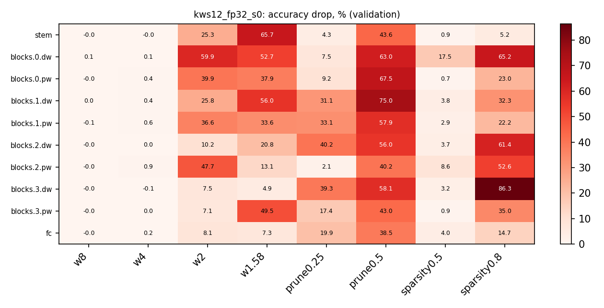

# bitladder

[](https://github.com/Vzzzz/bitladder/actions/workflows/ci.yml)
[](https://colab.research.google.com/github/Vzzzz/bitladder/blob/main/colab/kws.ipynb)
[](LICENSE)

*Русская версия: [README.md](README.md).*

**A ladder from 32 bits down to 1.** Extreme optimization of tiny always-on neural
networks: quantization-aware training (uniform, ternary 1.58-bit, binary), pruning,
per-layer sensitivity analysis, and honest accounting of what is left in bytes,
operations and milliseconds on real hardware. Two applied tracks: a **wake word on a
microcontroller** and **voice enhancement with a minimal parameter count** for a phone
and a Jetson.

The applied target is the wake word for [Kostyan](https://github.com/Vzzzz/skull-assistant/),
a voice assistant in an anatomical skull: an MCU listens all the time and wakes a sleeping
Jetson Orin Nano on the keyword.

Inspired by [ViT-1.58b: Mobile Vision Transformers in the 1-bit Era](https://arxiv.org/abs/2406.18051).

## Results so far (2026-10-25)

Keyword spotting on Google Speech Commands v2 with a DS-CNN 64×4 (23k parameters, 10.6 MMAC):

| what | number |
|---|---|
| 12-class accuracy, official test set | **95.0 %** (Hello Edge, DS-CNN S: 94.4 %) |
| base model after 4-bit QAT | 16 KB instead of 90 KB, same accuracy |
| **a new keyword added to a frozen base** (branch ≤ 10k params, ternary weights) | **1.5 KB of flash** at 8.6 % FRR, or **4.2 KB** at 6.6 % (FAR 1 %, two word pairs, 3 seeds) |

*Modular expansion* reproduces [Yandex, Interspeech 2026](https://arxiv.org/abs/2607.19918):
the base network is frozen and only a small branch is trained per new keyword. The
ordering of methods from the paper holds (branch < separate model < head-only). What the
paper does not have: 4-bit QAT of the base is free; ternary branch weights cost 1–4 FRR
points and hit depthwise convolutions first, which the layer analyzer confirms
independently. The paper reports 4.37 % over five word pairs with an int8 branch of about 10 KB. The paper's core-first arbitration rule
does not survive unseen, acoustically close keywords, and calibrating thresholds on hard
negatives (Common Voice) does not fix it. Tables, protocol and open questions in English:
[docs/results/kws_expansion.en.md](docs/results/kws_expansion.en.md); full working notes in Russian:
[docs/results/kws_expansion_2026-10-23.md](docs/results/kws_expansion_2026-10-23.md).

One-shot layer sensitivity of the 12-class model (accuracy drop in points when only that
layer is quantized / pruned, no retraining): 8 and 4 bits are free everywhere; depthwise
layers are fragile; pointwise layers tolerate 50 % unstructured sparsity almost for free.
[Report](docs/results/kws12_layer_analysis_2026-10-24.md).



## Layout

```
bitladder/            library
  quant/              STE weight quantizers (uniform / LSQ, ternary BitNet, binary XNOR), PACT
                      activations, QuantConv2d / QuantLinear, apply_quantization
  measure/            bytes after bit packing, MACs and BOPs, layer analyzer (weight and
                      activation statistics, one-shot sensitivity to bits and pruning)
  models/, data/      tiny models and loaders for the MNIST sandbox
  cli.py, train.py    shared quantization CLI args, training loop
audio/kws/            keyword spotting: log-mel without torchaudio, feature cache, DS-CNN,
                      run.py (training), expand.py (modular expansion), analyze.py,
                      cv_negatives.py (hard negatives from Common Voice)
colab/kws.ipynb       the same scripts in Google Colab for long sweeps
sandbox_mnist/        MNIST warm-up
docs/                 plan, decision log (ADR), literature review, hardware notes, results
tests/                31 unit tests (quantizers, packing, sizes, data pipeline, analyzer, GRU, distillation)
results/              run artifacts (not in git)
```

Documentation is in Russian: [plan](docs/plan.md), [decision log](docs/decision-log.md),
[literature review](docs/PUBLICATIONS.md), [results](docs/results/),
[hardware](docs/hardware.md). `CLAUDE.md` is the context file for the coding agent the
project is developed with; it doubles as the up-to-date project status.

## Quick start

```bash
python -m venv .venv && source .venv/bin/activate
pip install torch torchvision --index-url https://download.pytorch.org/whl/cu130   # or cu128 / cpu
pip install -e ".[dev]"
pytest -q

# Speech Commands v2 (CC BY 4.0): http://download.tensorflow.org/data/speech_commands_v0.02.tar.gz
# and speech_commands_test_set_v0.02.tar.gz, extracted into data/
python audio/kws/cache.py --root data/speech_commands_v2 --test-root data/speech_commands_test_v2
python audio/kws/run.py --epochs 30                                   # 12 classes, fp32
python audio/kws/run.py --keywords yes,no,up,down,left,right,on,off --exclude stop,go --unknown-ratio 1.0 --name base8
python audio/kws/expand.py --base results/base8.json --new stop,go --k 16 --separable --epochs 20
python audio/kws/expand.py --base results/base8.json --new stop,go --k 16 --separable --scheme ternary --abits 8 --no-first-last
python audio/kws/analyze.py --run results/base8.json                  # sensitivity table and heatmap
```

Every run writes a JSON and a checkpoint to `results/`: accuracy or FRR, parameters,
bytes after bit packing, MACs and BOPs. Reported numbers were obtained with torch 2.14.1
(cu130, RTX 3080 Laptop) and torch 2.11.0 (cu130, Colab T4); machine-to-machine spread
is larger than seed spread, so compare rows only within one environment.

## Data and licenses

- [Speech Commands v2](https://arxiv.org/abs/1804.03209) (Warden, 2018), CC BY 4.0.
- [Common Voice](https://commonvoice.mozilla.org/) (Mozilla), CC0; used only as hard
  negatives for threshold calibration.
- Modular expansion follows Khaymonenko et al., *Scalable Keyword Spotting via Modular
  Network Expansion*, Interspeech 2026, [arXiv 2607.19918](https://arxiv.org/abs/2607.19918).
- DS-CNN and the KWS protocol follow Zhang et al., *Hello Edge*, [arXiv 1711.07128](https://arxiv.org/abs/1711.07128).

Code is MIT-licensed. If you use it, a link back is appreciated.

## Status

Phase 1, wake-word track. Next steps are listed in [CLAUDE.md](CLAUDE.md) (in Russian).
