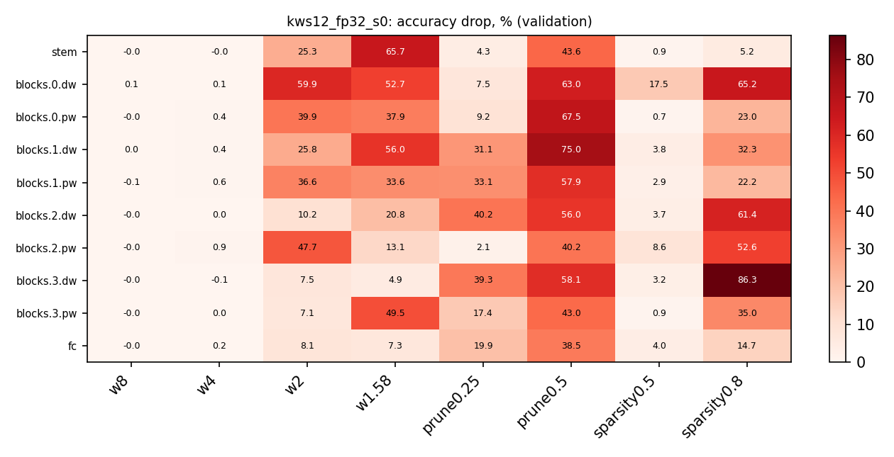

# bitladder

[](https://github.com/Vzzzz/bitladder/actions/workflows/ci.yml)
[](https://colab.research.google.com/github/Vzzzz/bitladder/blob/main/colab/kws.ipynb)
[](LICENSE)

*English version: [README.en.md](README.en.md).*

**Лесенка от 32 до 1 бита.** Экстремальная оптимизация маленьких нейросетей для
always-on устройств: квантование с дообучением (uniform, тернарное 1.58 бит, бинарное),
прунинг, анализ чувствительности слоёв и честный подсчёт того, что остаётся в байтах,
операциях и миллисекундах на реальном железе. Два прикладных трека: **wake word на
микроконтроллере** и **voice enhancement на минимуме параметров** для смартфона и Jetson.

Прикладная цель: wake word для голосового ассистента
[Костяна](https://github.com/Vzzzz/skull-assistant/), который слушает всегда на
микроконтроллере и будит спящий Jetson Orin Nano по ключевому слову.

Вдохновение: [ViT-1.58b: Mobile Vision Transformers in the 1-bit Era](https://arxiv.org/abs/2406.18051).

## Результаты на сегодня (2026-11-03)

Keyword spotting на Google Speech Commands v2, DS-CNN 64×4 (23k параметров, 10.6 MMAC),
Colab T4, три сида там, где указано ± σ:

| что | число |
|---|---|
| точность на официальном тесте, 12 классов, fp32 | **95.2 %** (Hello Edge, DS-CNN S: 94.4 %) |
| лесенка битов той же модели (QAT, первый и последний слой 8 бит) | 4 бита: **95.2 % в 16 КБ**; тернарные веса: **92.5 % в 10.6 КБ**; 2 бита: 88.2 % в 11.5 КБ; бинарные: 84.5 % в 9.2 КБ |
| новое слово поверх замороженной базы 64×4 (ветка ≤ 10k параметров) | 4.2 КБ при FRR 6.6 % (4 бита) или 1.5 КБ при 8.6 % (тернарные), две пары слов |
| новое слово поверх базы 128×6 (69 КБ в 4 битах, 55 MMAC) | **6.3 КБ при 4.3 ± 2.1 %**, 2.2 КБ при 5.3 ± 1.8 %, 1.4 КБ при 6.6 ± 1.8 % (FAR 1 %, две пары, три сида) |

*Модульное расширение* воспроизводит [Яндекс, Interspeech 2026](https://arxiv.org/abs/2607.19918):
база заморожена, на каждое новое слово обучается только маленькая ветка. Порядок
методов из статьи сохраняется (ветка лучше отдельной модели, та лучше одной головы);
число статьи, 4.37 % по пяти парам при int8-ветке около 10 КБ, достигается веткой в
6.3 КБ на базе 128×6. Чего в статье нет: главный рычаг это размер базы, а не ветки;
база в 4 битах бесплатна (три сида); дистилляция от большой базы даёт малой +0.3 пункта
и ветке −0.9 пункта FRR при тех же байтах; тернарные веса ветки стоят 2.5 пункта за
половину байт и бьют прежде всего по depthwise-свёрткам; смешанная точность по
анализатору ничего не добавляет, пока 4 бита бесплатны. Правило «сначала ядро» из
статьи не выживает на невиданных акустически близких словах, и калибровка порогов на
трудных негативах (Common Voice) этого не чинит. Таблицы и протокол:
[docs/results/kws_expansion_2026-10-23.md](docs/results/kws_expansion_2026-10-23.md),
краткая английская версия с вопросами к авторам: [kws_expansion.en.md](docs/results/kws_expansion.en.md).

Тернарная модель на 12 классах и меньше, и на четыре пункта точнее 2-битной, как у
ViT-1.58b, только на модели в 10⁴ раз меньше; ниже 4 бит лесенка по байтам упирается в
8-битные первый и последний слой (около 3.5 КБ).

Чувствительность слоёв 12-классовой модели одним прогоном (падение точности в
пунктах, когда только этот слой квантуется или прунится, без дообучения): 8 и 4 бита
бесплатны везде, depthwise-слои хрупкие, pointwise-слои терпят 50 % разреженности
почти даром. QAT возвращает почти всё, что одношаговый анализ предсказывал потерянным.
[Отчёт](docs/results/kws12_layer_analysis_2026-10-24.md).



## Структура проекта

```
bitladder/            библиотека
  quant/              STE-квантователи весов (uniform / LSQ, тернарный BitNet, бинарный XNOR),
                      PACT для активаций, слои QuantConv2d / QuantLinear, apply_quantization
  measure/            байты после упаковки битов, MACs и BOPs, анализатор слоёв
                      (статистика весов и активаций, чувствительность к битам и прунингу)
  models/, data/      маленькие модели и загрузчики для песочницы MNIST
  cli.py, train.py    общие аргументы квантования, цикл обучения
audio/kws/            keyword spotting: log-mel без torchaudio, кэш признаков, DS-CNN,
                      run.py (обучение), expand.py (модульное расширение), analyze.py,
                      cv_negatives.py (негативы из Common Voice)
colab/kws.ipynb       те же скрипты в Google Colab для длинных свипов
sandbox_mnist/        разогрев на MNIST
docs/                 план, decision-log (ADR), литобзор, железо, результаты
tests/                31 юнит-тест (квантователи, упаковка, размеры, конвейер данных, анализатор, GRU, дистилляция)
results/              артефакты прогонов (в git не входят)
```

## Документы

- [docs/plan.md](docs/plan.md): цели, вопросы исследования, треки, методы, метрики, устройства.
- [docs/decision-log.md](docs/decision-log.md): журнал решений в формате ADR.
- [docs/PUBLICATIONS.md](docs/PUBLICATIONS.md): литобзор, записи P-NNN с проверяемыми следствиями.
- [docs/results/](docs/results/): сводные таблицы экспериментов.
- [docs/hardware.md](docs/hardware.md): Jetson, микроконтроллер, аудио.
- [docs/stm32_deploy.md](docs/stm32_deploy.md): пошаговое развёртывание wake word на STM32F407G-DISC1.
- [docs/references.md](docs/references.md): стартовый список статей и инструментов.
- [AGENTS.md](AGENTS.md): контекст для агента, с которым ведётся разработка; заодно
  актуальный статус проекта и ближайшие шаги.

## Быстрый старт

```bash
python -m venv .venv && source .venv/bin/activate
pip install torch torchvision --index-url https://download.pytorch.org/whl/cu130   # или cu128 / cpu
pip install -e ".[dev]"
pytest -q

# Speech Commands v2 (CC BY 4.0): http://download.tensorflow.org/data/speech_commands_v0.02.tar.gz
# и тестовый набор speech_commands_test_set_v0.02.tar.gz, распакованные в data/
python audio/kws/cache.py --root data/speech_commands_v2 --test-root data/speech_commands_test_v2
python audio/kws/run.py --epochs 30                                   # 12 классов, fp32
python audio/kws/run.py --keywords yes,no,up,down,left,right,on,off --exclude stop,go --unknown-ratio 1.0 --name base8
python audio/kws/expand.py --base results/base8.json --new stop,go --k 16 --separable --epochs 20
python audio/kws/expand.py --base results/base8.json --new stop,go --k 16 --separable --scheme ternary --abits 8 --no-first-last
python audio/kws/analyze.py --run results/base8.json                  # таблица и тепловая карта чувствительности
```

Каждый прогон пишет JSON и чекпоинт в `results/`: точность или FRR, параметры,
байты после упаковки битов, MACs и BOPs. Опубликованные числа получены на torch 2.14.1
(cu130, RTX 3080 Laptop) и torch 2.11.0 (cu130, Colab T4); разброс между машинами
больше, чем между сидами, поэтому строки сравниваются только внутри одного окружения.

## Данные и лицензии

- [Speech Commands v2](https://arxiv.org/abs/1804.03209) (Warden, 2018), CC BY 4.0.
- [Common Voice](https://commonvoice.mozilla.org/) (Mozilla), CC0; используется только
  как трудные негативы для калибровки порогов.
- Модульное расширение по Khaymonenko et al., *Scalable Keyword Spotting via Modular
  Network Expansion*, Interspeech 2026, [arXiv 2607.19918](https://arxiv.org/abs/2607.19918).
- DS-CNN и протокол KWS по Zhang et al., *Hello Edge*, [arXiv 1711.07128](https://arxiv.org/abs/1711.07128).

Код под лицензией MIT. Пользуйтесь на здоровье, ссылка на репозиторий приветствуется.

## Статус

Фаза 1, трек wake word. Следующие шаги в [AGENTS.md](AGENTS.md), раздел «Ближайшие шаги».
